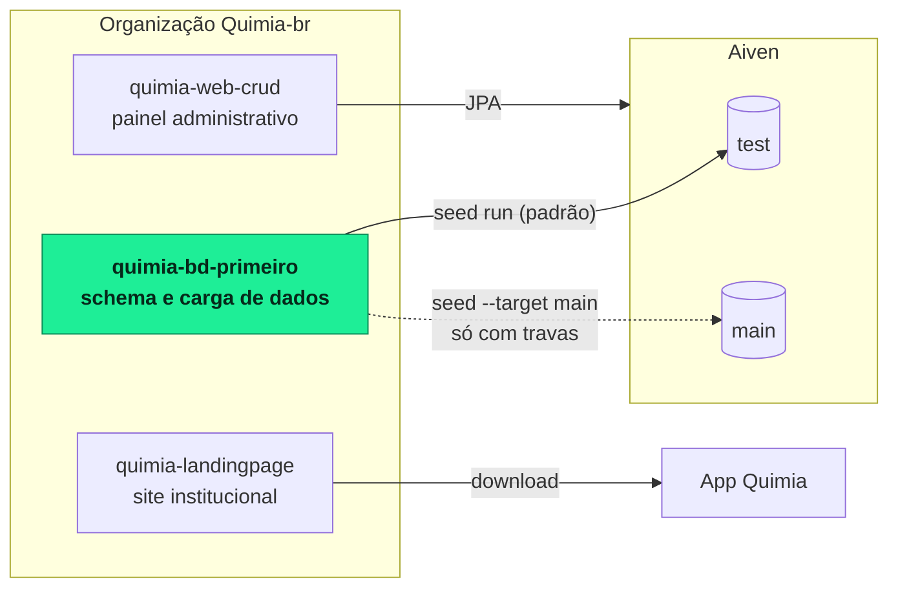
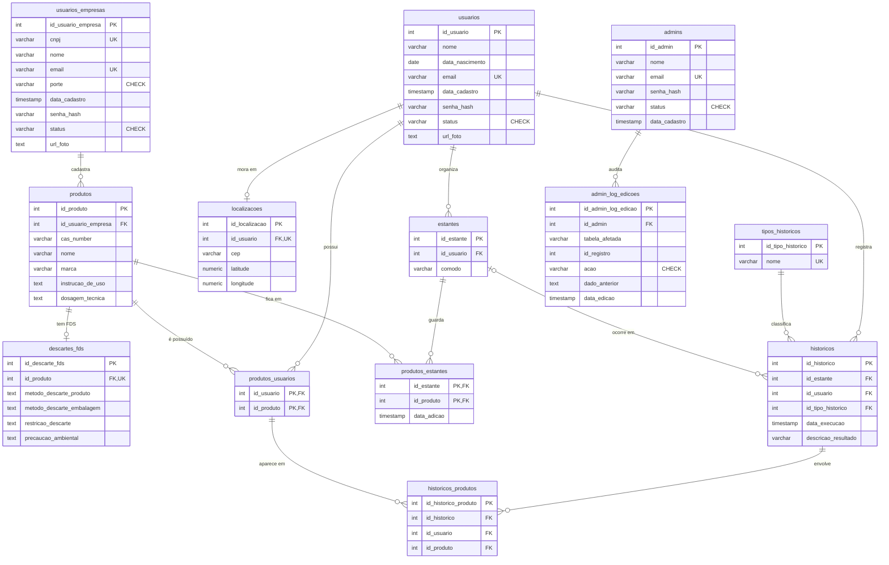
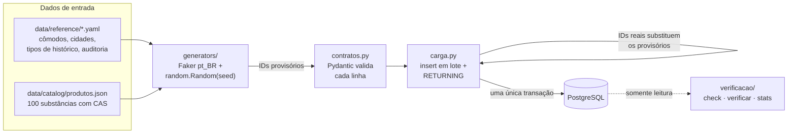
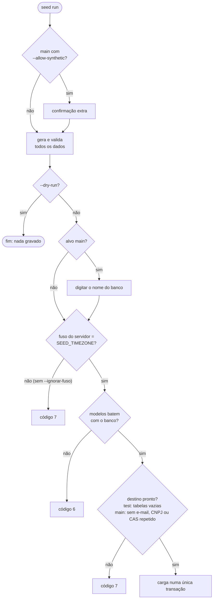

<a id="top"></a>

<div align="center">


# Quimia · Banco de Dados e Carga

**Schema PostgreSQL do Quimia e a ferramenta de carga (seed) que popula os bancos com dados coerentes, válidos, reproduzíveis e seguros.**

[](https://www.python.org/)
[](https://aiven.io/postgresql)
[](https://www.sqlalchemy.org/)
[](https://docs.pydantic.dev/)
[](https://docs.astral.sh/uv/)

[](https://docs.astral.sh/ruff/)
[](https://mypy-lang.org/)
[](#qualidade-e-testes)
[](.pre-commit-config.yaml)
[](https://www.conventionalcommits.org/)
[&style=flat-square)](https://github.com/Quimia-br/quimia-bd-primeiro/commits/develop)

[Modelo de dados](#modelo-de-dados) ·
[Instalação](#instalação) ·
[Comandos](#comandos) ·
[Travas de segurança](#travas-de-segurança) ·
[Decisões](#decisões-de-projeto)

</div>

---

## Sumário

- [Sobre](#sobre)
- [O ecossistema Quimia](#o-ecossistema-quimia)
- [Modelo de dados](#modelo-de-dados)
- [Como a carga funciona](#como-a-carga-funciona)
- [Instalação](#instalação)
- [Configuração dos bancos](#configuração-dos-bancos)
- [Comandos](#comandos)
- [Travas de segurança](#travas-de-segurança)
- [Qualidade e testes](#qualidade-e-testes)
- [Estrutura do projeto](#estrutura-do-projeto)
- [Decisões de projeto](#decisões-de-projeto)
- [Contribuindo](#contribuindo)
- [Equipe](#equipe)

## Sobre

O **Quimia** é um aplicativo que ajuda a evitar misturas perigosas de produtos de limpeza. Este repositório guarda duas coisas:

1. **O schema do banco** (pasta [`database/`](database/README.md): `database/sql/01_ddl.sql` e `database/sql/02_fks.sql`), a fonte da verdade das 13 tabelas.
2. **A ferramenta de carga `seed`**, uma linha de comando em Python que popula os bancos `test` e `main` (dois serviços no Aiven) com 100 registros por tabela, gerados de forma determinística e validados antes de chegar ao banco.

> [!CAUTION]
> Os scripts de `database/sql/` começam com `DROP TABLE ... CASCADE`. **Nunca execute esses scripts no Aiven** sobre um banco com dados. A ferramenta de carga nunca os executa.

<p align="right"><a href="#top">voltar ao topo</a></p>

## O ecossistema Quimia



<p align="right"><a href="#top">voltar ao topo</a></p>

## Modelo de dados



<details>
<summary><b>Regras que o schema garante</b></summary>

<br>

| Regra | Como |
|---|---|
| A estante de um histórico pertence ao mesmo usuário | FK composta `historicos (id_estante, id_usuario) → estantes (id_estante, id_usuario)` |
| Um histórico só envolve produtos que o usuário possui | FK composta `historicos_produtos (id_usuario, id_produto) → produtos_usuarios` |
| Uma estante por cômodo, por usuário | `UNIQUE (id_usuario, comodo)` em `estantes` |
| Uma localização por usuário e um descarte por produto | `UNIQUE` em `localizacoes.id_usuario` e `descartes_fds.id_produto` |
| Status, porte e ação dentro de valores fixos | `CHECK` em `status`, `porte` e `acao` |
| Coordenadas válidas e fotos com URL | `CHECK` de latitude, longitude e `url_foto LIKE 'http%'` |

`cas_number` **não** é `UNIQUE`: várias marcas podem usar a mesma substância.

</details>

<p align="right"><a href="#top">voltar ao topo</a></p>

## Como a carga funciona



1. **Geração determinística.** Os geradores usam Faker `pt_BR` e `random.Random` com uma única semente (`--seed`, padrão `42`): a mesma semente gera os mesmos dados.
2. **IDs provisórios.** Cada linha recebe o ID `posição + 1` da sua tabela, e as chaves estrangeiras usam esses IDs. Na carga, eles são trocados pelos IDs reais devolvidos pelo `RETURNING`.
3. **Validação antes do banco.** Os contratos Pydantic conferem tamanhos, valores dos `CHECK`, CAS, CNPJ, CEP, e-mail, URL e datas. Um erro aparece com o nome do campo antes de chegar ao banco.
4. **Transação única.** Cada tabela é inserida com um único `insert(...)` em lote, na ordem das FKs. Se qualquer tabela falhar, nada fica gravado.

<details>
<summary><b>O que é gerado em cada tabela (semente 42)</b></summary>

<br>

| Tabela | Linhas | Observação |
|---|---:|---|
| `usuarios` | 100 | 18 anos ou mais na data de cadastro; 10% sem data de nascimento |
| `usuarios_empresas` | 100 | CNPJ válido (inclui o formato alfanumérico) |
| `localizacoes` | 100 | Uma por usuário, com CEP coerente com a cidade |
| `produtos` | 100 | Um por entrada do catálogo |
| `descartes_fds` | 100 | Um por produto |
| `produtos_usuarios` | 100 | Concentrados em 25 a 37 usuários, para permitir misturas |
| `estantes` | 100 | Todo dono de produto tem de 1 a 3 estantes |
| `produtos_estantes` | 100 | Cada produto possuído fica em uma estante do dono |
| `historicos` | 100 | Respeitam as regras de cada tipo |
| `historicos_produtos` | 100 | Somam exatamente 100, dentro do mínimo e máximo de cada tipo |
| `tipos_historicos` | 5 | USO, MISTURA, DESCARTE, ARMAZENAMENTO, VERIFICACAO |
| `admins` | 0 | Cadastrados fora do seed |
| `admin_log_edicoes` | 0 | `id_admin` é NOT NULL: sem admins não há log |

Você pode conferir sem tocar no banco com `uv run seed run --dry-run`.

</details>

<p align="right"><a href="#top">voltar ao topo</a></p>

## Instalação

Requisitos: [uv](https://docs.astral.sh/uv/getting-started/installation/) (Windows, macOS ou Linux) e Git. O uv instala o Python 3.14 sozinho, se faltar. Os comandos abaixo funcionam igual em PowerShell, Bash e Zsh. O repositório tem duas pastas: [`database/`](database/README.md) (schema) e [`dataload/`](dataload/README.md) (ferramenta de carga). **Todos os comandos `uv` deste README rodam dentro de `dataload/`.**

```bash
git clone https://github.com/Quimia-br/quimia-bd-primeiro.git
cd quimia-bd-primeiro
git switch develop

# a ferramenta de carga fica na pasta dataload/: todos os comandos uv abaixo rodam nela
cd dataload
uv sync                                            # cria .venv e instala dependências + grupo dev
uv run pre-commit install                          # hooks de qualidade no git commit
uv run pre-commit install --hook-type commit-msg   # verificação da mensagem de commit
```

<p align="right"><a href="#top">voltar ao topo</a></p>

## Configuração dos bancos

| Passo | O que fazer |
|:---:|---|
| **1** | **Certificados:** no console do Aiven (*serviço → Overview → CA certificate*), baixe o CA de cada serviço e salve em `dataload/certs/ca-test.pem` e `dataload/certs/ca-main.pem`. A pasta fica fora do Git. |
| **2** | **Allowlist:** em *Service settings → Allowed IP addresses*, libere o IP da sua máquina nos dois serviços. Sem isso, a conexão termina em timeout. |
| **3** | **Variáveis:** crie os dois arquivos, dentro de `dataload/`, a partir do modelo e preencha host, porta, usuário, senha e caminho do CA de cada serviço. |
| **4** | **Conferência:** rode `uv run seed check` (test) e `uv run seed --target main check` (main). O comando só lê. |

| Sistema | Comandos |
|---|---|
| Windows (PowerShell) | `Copy-Item .env.example .env.test` (banco de teste, alvo padrão) e `Copy-Item .env.example .env` (banco principal) |
| macOS e Linux | `cp .env.example .env.test` (banco de teste, alvo padrão) e `cp .env.example .env` (banco principal) |

<details>
<summary><b>Variáveis do <code>.env</code></b></summary>

<br>

| Variável | Exemplo | Para quê |
|---|---|---|
| `SEED_DB_HOST` | `pg-exemplo.aivencloud.com` | Host do serviço no Aiven |
| `SEED_DB_PORT` | `12345` | Porta do serviço (no Aiven não é a 5432) |
| `SEED_DB_USER` | `avnadmin` | Usuário do serviço |
| `SEED_DB_PASSWORD` | | Senha do serviço |
| `SEED_DB_NAME` | `defaultdb` | Nome do banco |
| `SEED_DB_SCHEMA` | `public` | Schema |
| `SEED_DB_SSLMODE` | `verify-ca` | Modo SSL (ver [ADR 0003](dataload/docs/adr/0003-ssl-verify-ca.md)) |
| `SEED_DB_SSLROOTCERT` | `certs/ca-test.pem` | CA do serviço |
| `SEED_DB_POOL_SIZE` / `SEED_DB_MAX_OVERFLOW` | `2` / `1` | Pool pequeno, pelo limite de conexões do Aiven |
| `SEED_DB_CONNECT_TIMEOUT` | `10` | Segundos de espera ao conectar |
| `SEED_TIMEZONE` | `UTC` | Fuso das colunas `TIMESTAMP`; deve ser igual ao do servidor |
| `SEED_PASSWORD_PLAIN` | | Senha dos usuários fictícios; use uma diferente em cada arquivo |

Uma variável definida no ambiente tem prioridade sobre o arquivo (PowerShell: `$env:SEED_DB_NAME = "..."`; Bash e Zsh: `export SEED_DB_NAME=...`).

</details>

> [!WARNING]
> O `.env` é o arquivo do banco **principal**. Como várias ferramentas carregam o `.env` automaticamente, há duas proteções: o `.vscode/settings.json` não injeta o `.env` no editor, e o alvo `test` aborta se resolver para o mesmo host e porta do `.env`.

<p align="right"><a href="#top">voltar ao topo</a></p>

## Comandos

O alvo padrão de todos os comandos é sempre `test`. Para o banco principal, use `--target main` antes do comando.

| Comando | Conecta? | Grava? | O que faz |
|---|:---:|:---:|---|
| `uv run seed validate` | não | não | Valida `data/reference` e `data/catalog` |
| `uv run seed check` | sim | não | Diagnóstico do servidor e comparação modelos × banco |
| `uv run seed verificar` | sim | não | Regras de negócio no banco: aprovada ou reprovada por regra |
| `uv run seed stats` | sim | não | Linhas por tabela |
| `uv run seed run --dry-run` | não | não | Gera e valida tudo, sem conectar nem gravar |
| `uv run seed run --seed 42` | sim | **sim** | Carga completa numa única transação |
| `uv run seed reset` | sim | **sim** | Esvazia as 13 tabelas e reinicia as identities (só no `test`, pede confirmação) |

<details>
<summary><b>Opções e códigos de saída</b></summary>

<br>

| Opção | Comando | Efeito |
|---|---|---|
| `--target test\|main` | todos | Banco de destino (também pela variável `SEED_TARGET`) |
| `--seed N` | `run` | Semente da geração |
| `--dry-run` | `run` | Não conecta nem grava |
| `--allow-synthetic` | `run` | Permite dados sintéticos no `main` |
| `--ignorar-fuso` | `run` | Carrega mesmo com o fuso do servidor diferente de `SEED_TIMEZONE` |
| `--yes` | `reset` | Não pede confirmação |

| Código | Significado |
|:---:|---|
| `0` | OK |
| `1` | Erro |
| `2` | Uso inválido |
| `3` | Configuração |
| `4` | Conexão |
| `5` | Dados |
| `6` | Modelos × banco divergentes |
| `7` | Bloqueado por trava |
| `8` | Regra de negócio reprovada |

</details>

<p align="right"><a href="#top">voltar ao topo</a></p>

## Travas de segurança

Antes de gravar, o `seed run` passa por uma sequência de travas. Qualquer uma que falhe encerra a carga sem gravar nada.



> [!IMPORTANT]
> Sem `--allow-synthetic`, o `main` recebe só os tipos de histórico. Com a opção, só entram produtos de entradas revisadas do catálogo e a carga apenas acrescenta: nunca sobrescreve nem apaga. O `reset` é bloqueado no `main` pelo código, e a auditoria sintética nunca é gravada lá.

<p align="right"><a href="#top">voltar ao topo</a></p>

## Qualidade e testes

```bash
uv run ruff check           # lint (inclui regras de segurança do Bandit)
uv run ruff format --check  # formatação
uv run mypy                 # tipos (modo com plugin do Pydantic)
uv run pytest               # 318 testes, nenhum conecta a banco
```

Os testes conferem, entre outras coisas, que os modelos ORM batem com o `database/sql/01_ddl.sql`, que os contratos batem com os modelos, que os enums batem com os `CHECK` do DDL, as travas da CLI e os validadores de CAS, CNPJ, CEP e fuso.

<details>
<summary><b>Hooks do pre-commit</b></summary>

<br>

| Hook | O que garante |
|---|---|
| `ruff-check` e `ruff-format` | Lint com correção automática e formatação |
| `mypy` | Tipagem do projeto |
| `detect-private-key` | Nenhuma chave privada no commit |
| `check-added-large-files` | Nenhum arquivo grande por engano |
| `end-of-file-fixer`, `trailing-whitespace`, `mixed-line-ending` | Arquivos com LF e sem espaços sobrando (os scripts de `database/sql/` ficam como foram entregues) |
| `check-yaml`, `check-toml` | YAML e TOML válidos |
| `sem-coautoria-claude` | Mensagem de commit sem linha de coautoria de assistente de IA |

</details>

<p align="right"><a href="#top">voltar ao topo</a></p>

## Estrutura do projeto

<details>
<summary><b>Ver a árvore de pastas</b></summary>

<br>

```
quimia-bd-primeiro/
├── database/                 schema e modelagem (ver database/README.md)
│   ├── sql/
│   │   ├── 01_ddl.sql        tabelas, CHECKs e UNIQUEs (fonte da verdade)
│   │   ├── 02_fks.sql        chaves estrangeiras
│   │   └── 03_views.sql      views do dashboard
│   ├── docs/nomenclatura/    convenção de nomenclatura e padronização SQL
│   └── legacy/               seeds JSON e requirements.txt antigos, só para consulta
├── dataload/                 ferramenta de carga (seed), em Python (ver dataload/README.md)
│   ├── data/
│   │   ├── reference/        YAML: cômodos, cidades, tipos de histórico, auditoria
│   │   └── catalog/          JSON: catálogo de 100 produtos
│   ├── src/seed/
│   │   ├── config.py         alvos, conexão, quantidades e formatos das URLs de foto
│   │   ├── modelos.py        modelos ORM espelhando o DDL e ordem de carga
│   │   ├── contratos.py      contratos Pydantic por tabela
│   │   ├── validacao.py      validadores puros: CAS, CNPJ, CEP, coordenadas, URL, idade, fuso
│   │   ├── dados.py          leitura de data/
│   │   ├── generators/       contas, produtos, estantes, historicos, contexto
│   │   ├── carga.py          inserts em lote, registro de IDs, transação única
│   │   ├── verificacao/      diagnostico, schema (modelos × banco), regras de negócio
│   │   └── cli/              Typer: app, consulta (leitura), escrita (run e reset)
│   ├── tests/unit/           testes unitários, sem banco
│   ├── docs/adr/             decisões de projeto (ADRs numerados)
│   ├── .env.example          modelo de configuração (valores fictícios)
│   └── pyproject.toml
├── LICENSE
└── .pre-commit-config.yaml
```

Um módulo vira pasta quando passa de cerca de 300 linhas ou tem partes claramente separadas, como `generators/`, `verificacao/` e `cli/`.

</details>

<p align="right"><a href="#top">voltar ao topo</a></p>

## Decisões de projeto

As decisões técnicas do projeto (ambiente e conexão, schema, dados, geradores, carga e proteção do banco principal) estão registradas, com contexto e consequências, em [docs/adr/](dataload/docs/adr/README.md). Cada decisão é um ADR numerado, no formato Contexto, Decisão e Consequências.

Alguns pontos que costumam gerar dúvida:

- **SSL `verify-ca`, não `verify-full`:** [ADR 0003](dataload/docs/adr/0003-ssl-verify-ca.md).
- **`database/sql/` é a fonte da verdade e não há Alembic:** [ADR 0006](dataload/docs/adr/0006-sql-fonte-da-verdade-sem-alembic.md).
- **Catálogo de produtos de teste e revisão antes do `main`:** [ADR 0018](dataload/docs/adr/0018-catalogo-de-produtos-escrito-a-mao.md).
- **`admins` e `admin_log_edicoes` vazias:** [ADR 0021](dataload/docs/adr/0021-admins-e-auditoria-vazias.md).
- **Travas de proteção do banco principal:** [ADR 0028](dataload/docs/adr/0028-carga-sintetica-restrita-no-banco-principal.md) e [ADR 0029](dataload/docs/adr/0029-travas-do-banco-principal.md).

<p align="right"><a href="#top">voltar ao topo</a></p>

## Contribuindo

1. Parta da `develop` atualizada e crie uma branch com prefixo do tipo: `feat/`, `fix/`, `refactor/`, `test/`, `chore/`.
2. Escreva os commits no padrão [Conventional Commits](https://www.conventionalcommits.org/), no imperativo.
3. Rode `ruff`, `mypy` e `pytest` (o pre-commit já faz a maior parte) antes de abrir a PR.
4. Abra a PR para a `develop` e peça a revisão de alguém da equipe.

> [!TIP]
> Mudou o schema? Atualize `database/sql/`, `modelos.py` e `contratos.py` no mesmo commit, rode `uv run pytest` (em `dataload/`) e depois `uv run seed check` para confirmar que o banco de teste bate com os modelos.

<p align="right"><a href="#top">voltar ao topo</a></p>

## Equipe

<a href="https://github.com/Quimia-br/quimia-bd-primeiro/graphs/contributors">
  
</a>

Projeto desenvolvido para a **ExpoTech 2026**.

| Repositório | Papel |
|---|---|
| [`quimia-web-crud`](https://github.com/Quimia-br/quimia-web-crud) | Painel administrativo (Spring Boot) |
| [`quimia-landingpage`](https://github.com/Quimia-br/quimia-landingpage) | Site institucional, publicado em [quimia.tech](https://quimia.tech) |

<p align="right"><a href="#top">voltar ao topo</a></p>
